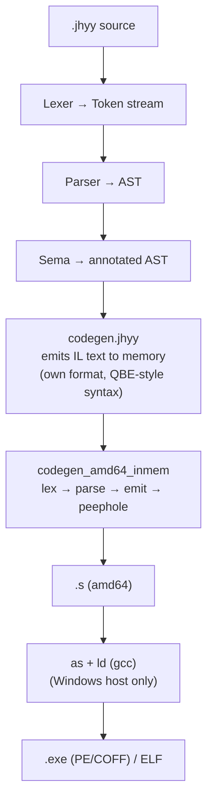
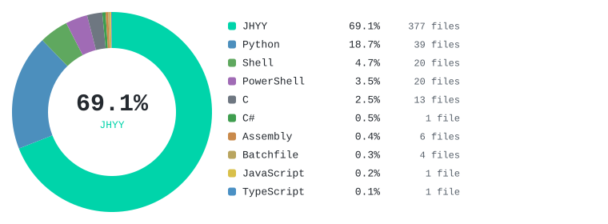

<div align="center">

<div></div>

<div></div>

### JHYY (机会翼游) — A self-hosted, statically typed, compiled systems programming language

**Statically typed. Expression-oriented. Compiled to native by a self-written amd64 backend.**

[](CHANGELOG.md)
[](#status-v415)
[](#architecture)
[](#install)
[](LICENSE)

[What is JHYY](#what-is-jhyy) · [Tour](#a-tour-of-the-syntax) · [Install](#install) · [Quick Start](#quick-start) · [Language](#language) · [CLI](#cli) · [Gotchas](#known-limitations) · [Architecture](#architecture) · [Layout](#project-layout) · [Status](#status-v415) · [Roadmap](#roadmap) · [Tools](#tools--integrations) · [Docs](#docs) · [License](#license)

**[Chinese version →](README.zh-CN.md)** ｜ This page describes **v4.1.5**. The language-spec baseline is **v4.0.0** (locked 2026-10-24); the v4.1.x deltas are in [CHANGELOG.md](CHANGELOG.md).

**Three ways in** — **Use it** → [Install](#install) · [Quick Start](#quick-start) · [CLI](#cli) ｜ **Build it** → [CONTRIBUTING.md](CONTRIBUTING.md) ｜ **Study it** → [Architecture](#architecture) · [language spec](docs/abis/jhyy-lang-spec-v4.0.0.md)

</div>

---

## What is JHYY

JHYY (机会翼游) is a self-designed, statically typed, expression-oriented, compiled systems
programming language. **The compiler is written in itself** — `compiler/src0/*.jhyy` is the
*only* implementation. `jhyy.exe` compiles `compiler/src0/main.jhyy`; the compiler that
produces compiles it again, and the closure gate **iterates until the emitted `.s` is
byte-identical** (the fixed point is reached, not assumed).

The backend is a **self-written in-memory amd64 code emitter**
(`compiler/src0/codegen_amd64_*.jhyy`) — no vendored QBE, no LLVM, no garbage
collector, and no managed runtime (the only runtime is a small C support library
that v4.5 replaces with pure JHYY).

**Where it sits:** JHYY is closest to **C** in spirit — explicit pointers, no
hidden runtime, a predictable ABI — and to **Zig** in ambition: a self-hosted
systems language meant to be good enough to host a kernel. It is deliberately
**not** trying to be Rust: only a minimal borrow check today, no traits yet, no GC.

**Design goals**:

- **Self-hosting** — the compiler compiles itself; the closure is verified by iteration to a
  fixed point (`.s` byte-identical across generations).
- **Native output** — direct amd64 code emission; PE/COFF executables on Windows, and SysV
  assembly that links into ELF binaries on Linux (the compiler itself runs on Windows only).
- **OS-ready** — `extern fn` FFI on the C ABI, `enum` + `match`, `#[no_std]`, `#[naked]`,
  inline `asm!`, `#[link_section]`, `volatile`, memory barriers, `defer`.

---

## A tour of the syntax

```rust
// Functions / variables / control flow / struct / match / enum / FFI
type Point = struct { x: i32, y: i32 }

fn dist_sq(a: Point, b: Point) -> i32 {
    let dx = a.x - b.x;
    let dy = a.y - b.y;
    dx * dx + dy * dy
}

fn classify(n: i32) -> *u8 {
    match n {
        0        => "zero",
        1..10    => "single digit",
        10 | 20  => "round number",
        _        => "other",
    }
}

extern fn printf(fmt: *u8, val: i32) -> i32;

fn main_jhyy() -> i32 {
    let p = Point { x: 3, y: 4 };
    let q = Point { x: 0, y: 0 };
    printf("d² = %d\n", dist_sq(p, q));
    printf("%s\n", classify(42));
    0
}
```

> ℹ️ Two things the tour is not showing: a string literal **is** a `*u8`
> (NUL-terminated UTF-8 bytes), so no cast is needed; and `extern fn` has **no
> variadic form** — every C argument is spelled out one by one, and the JHYY-side
> parameter types are **not checked** against the C signature.

---

## Install

### End users (Windows x64)

Grab the installer from
[**GitHub Releases**](https://github.com/JiHuiYiYou/JiHuiYiYou-compiler/releases/latest).
**MSYS2 is not required**: since v4.1.0 the installer bundles a minimal native ucrt64
toolchain (`<INSTALLDIR>\toolchain\`).

| Artifact | Size | What it is |
|---|---|---|
| [`jhyy-installer-4.1.5.exe`](https://github.com/JiHuiYiYou/JiHuiYiYou-compiler/releases/download/v4.1.5/jhyy-installer-4.1.5.exe) | ~54 MB | GUI installer — compiler + `.jhyy` file association + VS Code extension + PATH |
| [`jhyy-compiler-4.1.5.msi`](https://github.com/JiHuiYiYou/JiHuiYiYou-compiler/releases/download/v4.1.5/jhyy-compiler-4.1.5.msi) | ~27 MB | Same payload, no GUI — for enterprise / SCCM distribution |

Checksums are published alongside the assets as `SHA256.txt`.

⚠️ **The installer is not code-signed.** Windows SmartScreen therefore shows
*Windows protected your PC* on first run — click **More info → Run anyway**.
Unsigned binaries also trip third-party antivirus more often than signed ones.
The MSI meant for enterprise/SCCM distribution is unsigned as well, and some
organizations' software-distribution policies reject unsigned MSIs outright.

**Package managers**:

```powershell
# scoop (personal bucket)
scoop bucket add jhyy https://github.com/JiHuiYiYou/scoop-bucket
scoop install jhyy
```

`winget install JiHuiYiYou.JHYY` is **not available yet** — the upstream PR is still
awaiting review. Until it is merged, use scoop or the installer above.

Both install the same Burn bundle that is attached to the GitHub release, and verify
its SHA-256 before running it.

**VSCode users**: with the extension installed, `.jhyy` files get a ▶ run button in the
title bar (`Ctrl+F5`). Opening this repo triggers `.vscode/settings.json`, which adds
`compiler/build/bin` and the MSYS2 ucrt64 path to the integrated terminal — press
`Ctrl+Shift+B` to compile + run any `.jhyy` file.

### Not on Windows?

**The compiler itself is Windows-only** — `jhyy.exe` is a PE executable, and the
host must be Windows (or Wine). That is a design decision, not a bug
([`docs/internal/build.md`](docs/internal/build.md)).

The **output** is not Windows-only: the `amd64_sysv*` targets emit SysV assembly that
links and runs on Linux. The chain is three steps:

```bash
# 1. on Windows — emit the .s (a cross target must not be linked)
./compiler/build/bin/jhyy.exe compile --target=amd64_sysv_freestanding --no-link prog.jhyy -o prog
#    ⇒ prog.s

# 2. on Linux — link it into a static ELF
gcc -nostdlib -static -T runtime/linux_elf/link.ld -o prog.elf \
    runtime/linux_elf/crt0.S prog.s

# 3. run it
./prog.elf
```

CI runs exactly this chain on `ubuntu-latest` — see
[`compiler/tests/bootstrap/sysv_link_run.sh`](compiler/tests/bootstrap/sysv_link_run.sh).
The Linux runtime calls `main_jhyy` (not `main`) and exits with its return value, so
the entry convention is the same as on the hosted side — but the link is `-nostdlib`,
so a freestanding program must not call libc.

### Building from source

Needs MSYS2 + `mingw-w64-ucrt-x86_64-gcc` (the *build host* requirement — end users
don't need it):

```bash
git clone https://github.com/JiHuiYiYou/JiHuiYiYou-compiler.git
cd JiHuiYiYou-compiler
make all        # → compiler/build/bin/jhyy.exe (~2 MB)
```

> [!IMPORTANT]
> Do NOT use the MinGW `gcc` shipped with Git Bash (`/c/Program\ Files/Git/mingw64/bin/gcc.exe`)
> — it does not support PE+ linking and fails at link time.

The toolchain story (lookup order, the classic traps, version automation, multi-target
builds) is in [`docs/internal/build.md`](docs/internal/build.md); the contributor
workflow is in [`CONTRIBUTING.md`](CONTRIBUTING.md).

---

## Quick Start

### Hello world

```rust
// hello.jhyy
extern fn puts(s: *u8) -> i32;

fn main_jhyy() -> i32 {
    puts("Hello, world!");
    0
}
```

```bash
./compiler/build/bin/jhyy.exe run hello.jhyy
# => Hello, world!
```

> [!NOTE]
> **The entry point is `main_jhyy`, not `main`.** A hosted program must define
> `main_jhyy`; its real signature is `main_jhyy(argc: i32, argv: *u8) -> i32`,
> and `argc` / `argv` may be omitted. The C runtime's `main` bridges to it —
> see [spec § 1.1](docs/abis/jhyy-lang-spec-v4.0.0.md).

### The standard library

JHYY ships a small standard library. `import` pulls in a module — there is **no
`std::` prefix** (`import std::vec;` is a compile error):

```rust
// stdio.jhyy
import io;

extern fn puts(s: *u8) -> i32;

fn main_jhyy() -> i32 {
    io::std_io_print("hello from the JHYY stdlib\n");
    puts("and from libc, through extern fn");
    0
}
```

| Module | What it gives you |
|---|---|
| `mem` | `mem_copy` / `mem_set` / `mem_zero` / `mem_compare` / `mem_find_byte` |
| `fmt` | `fmt_i32` / `fmt_i64` / `fmt_str` / `fmt_hex_u32` — format into a byte buffer |
| `io` | file I/O (`std_io_open` / `std_io_read` / `std_io_write` / `std_io_close`) + `std_io_print` / `std_io_print_err` |
| `math` | `std_math_sin` / `std_math_cos` / `std_math_sqrt` / `std_math_pow` |
| `string` | length-prefixed strings: `str_from_cstr` / `str_concat` / `str_find` / `str_len` |
| `vec` | `std_vec_new` / `std_vec_push` / `std_vec_get` — byte vectors, **not** generic yet |
| `os` | raw POSIX / Win32 file descriptors + `getenv` |
| `arena` | bump allocator: `arena_init` / `arena_alloc` / `arena_reset` |

> ℹ️ A string literal is **already** a `*u8` — NUL-terminated UTF-8 bytes placed in
> `.data`. The `as *u8` cast seen in older examples is redundant. `\n` is the
> newline escape (the lexer happens to tolerate a raw newline inside a literal,
> but that is undocumented — don't rely on it).

Known gaps in the stdlib → [Known limitations](#known-limitations).

### Run the regression suite

```bash
python regress.py
# => 281 passed, 20 skipped (301 total)
```

What those numbers mean — one term, one definition each (the counts themselves live
in the [Status](#status-v415) table). The tool reports it as
`passed=281/301 failed=0` and `skipped=20`:

- **total** — every `.jhyy` file in `compiler/tests/examples/` except the
  `_`-prefixed helper fixtures.
- **runnable** — the harness runs these and checks a signal for each one.
- **real assertions** — the signal is an assertion written in the test source.
- **harness-decided** — the rest: the case expects a compile error
  (`// EXPECT-ERROR:`), or compares the process exit code.
- **skipped** — the case carries a `// SKIP:` directive, or is a library module with
  no entry point.

The assertion-strength audit (`python scripts/dev/audit_test_assertions.py --strict`)
reports **0 zero-signal** cases: no test passes without something being checked.

### Verify the self-host closure

```bash
make            # builds jhyy.exe, then iterates the closure to a fixed point
#   ⇒ _boot_new.s vs _boot_new2.s byte-identical
```

### Run with VSCode

With the extension installed, `.jhyy` files get a ▶ run button in the title bar
(`Ctrl+F5`).

---

## Language

| Category | Supported |
|----------|-----------|
| **Types** | `i8/i16/i32/i64`, `u8/u16/u32/u64`, `f32/f64`, `bool`, `*T`, `[T; N]`, `[*]T` (slice), `struct`, `enum`, `Cap<T>`, `PhantomData<T>` |
| **Sizes** | `sizeof(T)` / `alignof(T)` — compile-time constants |
| **Casts** | `as` — integer/float conversion, widening/narrowing, `*T ↔ i64/u64` |
| **Control flow** | `if`/`else` (expression-valued), `while`, `for i in start..end`, `break`, `continue`, `match` (literal/range/enum/wildcard, with exhaustiveness check) |
| **Cleanup** | `defer` — runs at scope exit (LIFO); not run on an implicit tail return |
| **Top-level const** | `const NAME: [T; N] = [...]` — compile-time emit to the `.data` section |
| **Logic** | `&&` / `\|\|` short-circuit, `!` / `~` unary |
| **Functions** | first-class, recursion, compound assignment (`+=` `-=` `*=` `/=` `%=`), block-expression closures (no capture — capturing is a compile error) |
| **Modules** | `import` + transitive imports, multi-file CLI, `mod::fn()` namespaces |
| **FFI** | `extern fn` calling C (printf, file I/O, multi-arg) |
| **OS / embedded** | `#[no_std]`, `#[naked]`, `#[link_section]`, `volatile`, inline `asm!`, memory barriers |
| **Stdlib** | `import mem;` / `fmt` / `io` / `math` / `string` / `vec` / `os` / `arena` — **note: no `std::` prefix** (`import std::vec;` is a compile error) |

The table above mixes very different states of maturity. The four entries below
are the ones that are easy to misread:

| Feature | State | What that means in practice |
|---|---|---|
| `[*]T` (slice) | ✅ usable | a **view** over an array — writes go through to the original, and indexing is **not** bounds-checked |
| `PhantomData<T>` | ⚠️ type-level only | legal as a struct field; instantiating it is a compile error (`E0050`) |
| `asm!` | ⚠️ limited | a **single string literal** only — no operand constraints, no clobbers; AT&T syntax, x86-64 only |
| `Cap<T>` | 🚧 layout only | the 8-byte layout is fixed and testable, but you cannot construct a value yet — real capability semantics land in v4.14 |

Full specification: [`docs/abis/jhyy-lang-spec-v4.0.0.md`](docs/abis/jhyy-lang-spec-v4.0.0.md)
(locked 2026-10-24; it replaces v1.3.0 + 17 v3.x supplements, both archived to git history).
Known limitations are collected in its **Appendix B**, not scattered through the prose.

---

## CLI

```text
jhyy compile <file.jhyy> [-o output]   compile + link -> .exe
jhyy build   <file.jhyy> [-o base]     compile only -> .s (no link; -o is a base name, .s appended)
jhyy run     <file.jhyy>              compile + link + execute
jhyy dump    <file.jhyy>              print the parsed AST tree (parse only)

flags:
  --target=<triple>  select target (default amd64_win)
  --no-link          compile to .s only, skip the gcc link (required for cross targets)
  --help             show help and exit
```

Targets: `amd64_win` (default, hosted Windows — **the only target this build can
link**) · `amd64_win_freestanding` (UEFI) · `amd64_sysv` ·
`amd64_sysv_freestanding` (the latter three produce a `.s` only — link it with
a toolchain that matches the target).

`jhyy dump` prints the **parsed AST** — one node per line, children indented, every
line tagged with `@file:line:col`. It stops after parsing, so it shows the *syntax*,
not the compiled form (use `jhyy build` for the `.s`).

> ℹ️ **Two different "builds".** `jhyy build` means "compile one `.jhyy` file to
> assembly". `make all` means "build the compiler". They are unrelated — renaming
> either would be a breaking change.

Command-line quirks (one input file, no `--version`, cross targets, and the rest)
→ [Known limitations](#known-limitations).

---

## Known limitations

Everything below is a **real, current limitation**, not a roadmap item. The
authoritative per-item version, with anchors, is the spec's
[**Appendix B**](docs/abis/jhyy-lang-spec-v4.0.0.md#附录-b未实装--已实装但受限);
this section is the short index, grouped by whether it will bite you while writing
code or only while typing commands.

### Affects the code you write

- **String literals are `*u8`** — NUL-terminated UTF-8 in `.data`. Not a slice, not
  an array: `let s: [*]u8 = "x";` is a type error (write `as [*]u8`).
- **`extern fn` has no variadic form** — a C function like `printf` must have every
  argument declared individually, and the declared parameter types are **not checked**
  against the C signature. A mismatch compiles and misbehaves at runtime.
- **Function argument types are not checked** — passing an `i32` where a `struct` is
  expected compiles, and reads the register as a struct at runtime.
- **Source files are UTF-8.** The lexer tolerates a raw newline inside a string
  literal; that is undocumented — use `\n`.
- **`Cap<T>` cannot be constructed** — the 8-byte layout is fixed, but there is no
  value to make yet.
- **`PhantomData<T>` cannot be instantiated** (`E0050`) — it is a type-level marker.
- **Slices are unchecked** — no bounds check on indexing; writes through a slice
  write through to the original array.
- **`asm!` is a single string literal** — no operand constraints, no clobbers;
  AT&T syntax, x86-64 only.
- **`()` is not accepted in type position** — `let x: () = ();` is a parse error.
- **Top-level variable initializers must be integer constant expressions** — a
  non-integer initializer is silently dropped and reads back as `0`.
- **The stdlib is small and young** — no float formatter, no `abs` / `min` / `max`,
  no `Vec<T>` over element types, and no `print` macro yet.

### Affects the command line only

- **There is no `jhyy --version`** — it never existed. Running it prints
  `jhyy: unknown option --version` (plus a `try jhyy --help` hint) and exits 1.
  The version banner is the **first line of `jhyy --help`** (and of `jhyy` with no
  arguments — both print the same help).
- **Exactly one input file.** Extra `.jhyy` arguments are **silently ignored** — no
  error, no warning — so `jhyy compile main.jhyy lib.jhyy` compiles **only**
  `main.jhyy`. Combine files with `import` instead: put `import lib;` in
  `main.jhyy` and the compiler pulls `lib.jhyy` in along the import graph.
- **Unrecognized options are rejected** — `jhyy compile --foo a.jhyy` reports
  `compile: unknown option --foo`; it does not mistake the flag for a file name.
- **Cross targets cannot be linked by this build.** `--target=amd64_sysv` (and the
  freestanding ones) emit code with that target's ABI, but the bundled linker always
  produces a **Windows `.exe`** — linking a SysV `.s` with it yields a binary that
  crashes at the first libc call. The compiler now **refuses** to link a cross
  target: pass `--no-link` and link the `.s` yourself with a matching toolchain
  (that is what `runtime/linux_elf/` is for).
- **`jhyy build` and `jhyy compile --no-link` produce byte-identical `.s`** (both
  apply `#[link_section]`, so the `.section` directives match too). The
  equivalence is pinned by the `link_section_build` artifact check.

---

## Architecture



| Piece | Where | Role |
|-------|-------|------|
| `compiler/src0/*.jhyy` | 31 modules | **The** compiler — lexer, parser, sema, IR, codegen, target dispatch |
| `compiler/src0/codegen_amd64_*.jhyy` | self-written backend | IL lexer · emitter (`emit_call` / `emit_ctrl` / `emit_mem` / `emit_sse`) · peephole · register cache |
| `compiler/src0/std/*.jhyy` | 8 modules | `mem` `fmt` `io` `math` `string` `vec` `os` `arena` |
| `compiler/runtime/runtime.c` | C runtime | Arena allocator + `main` → `main_jhyy` bridge |
| `runtime/linux_elf/` | crt0.S + link.ld | Linux ELF runtime for the `amd64_sysv*` targets |

**Why no QBE?** QBE was removed in v4.0.0 (post-v2.16.0). The self-written backend is now
the sole codegen path — that removes a 17K-LOC vendored dependency and tightens the
iteration loop on codegen itself. The **IL text is JHYY's own format**: it borrows QBE's
*syntax* as a starting point, but no QBE code is vendored, linked, or executed.

---

## Project layout

```
JiHuiYiYou-compiler/
├── compiler/
│   ├── src0/                   compiler sources (the only implementation, 31 modules + std/)
│   │   ├── std/                standard library: mem / fmt / io / math / string / vec / os / arena
│   │   └── codegen_amd64_*.jhyy self-written backend: IL lexer / emit_* / peephole / register cache
│   ├── runtime/                C runtime (arena + main entry)
│   ├── tests/
│   │   ├── examples/           integration tests — 301 cases (+9 `_`-prefixed fixtures) in 5 subdirectories; run by regress.py
│   │   └── bootstrap/          fixed_point.sh · closure_check.sh · artifact_checks.sh · byte_equal*.sh
│   └── build/bin/              jhyy.exe · jhyy_v1.exe.exe (self-hosted artifacts)
├── runtime/linux_elf/          Linux ELF runtime (crt0.S + link.ld)
├── bench/                      benchmark suite (tasks + driver + methodology + published snapshot)
├── regress.py                  regression test suite (repository root)
├── docs/                       specs / internal docs / plans / changelog
├── installer/                  WiX installer + bundled ucrt64 toolchain
├── mcp-jhyy/                   Claude Code MCP server (jhyy_* tools)
├── vscode-ext/                 VS Code extension
└── scripts/dev/                development scripts (bench / test / build / install)
```

> ℹ️ `jhyy_v1.exe.exe` is **not** a typo: `make` regenerates it as a byte-identical
> copy of `jhyy.exe` on every build, and the double extension is the historical
> name. It is a build artifact, not an input — but two local bootstrap gates
> (`byte_equal.sh`, `fixed_point.sh`) default to *this exact path* as their
> "generation 1" reference, so renaming it would silently break them.

---

## Status (v4.1.5)

In plain terms: **the regression suite is green** — every runnable case is checked and
none fails. The compiler compiles itself to a byte-identical result, and the workaround
ledger has **no known unfixed compiler bug**. The table below is the machine-readable
version; [FACTS.md § 2](docs/internal/FACTS.md) is the single source of truth for these
numbers.

| Metric | Value |
|--------|-------|
| `regress.py` (regression suite) | **281 PASS + 0 XFAIL + 0 failed + 20 SKIP** (301 total) |
| Assertion audit | 301 scanned · 281 runnable · 217 real assertions · 0 zero-signal |
| Benchmark suite | 9 tasks over 4 coverage axes — [published snapshot](bench/baseline/RESULTS-2026-11-04.md) (jhyy vs gcc wall clock; the code-quality floor is gcc `-O0`, not a pass/fail bar) |
| Self-host closure | `make` iterates to a fixed point — emitted `.s` byte-identical |
| `fixed_point.sh` | local gate (not in CI) — N=10 generations, `.il` and `.s` byte-equal |
| `artifact_checks.sh` | **23 gates** (PASS 23 / KNOWN-FAIL 0 / FAIL 0) |
| `closure_check.sh` | local gate (not in CI) — v2.s == v3.s, byte-identical |
| ACTIVE workarounds | **0** — see [FACTS.md § 3](docs/internal/FACTS.md) |
| `jhyy-installer-4.1.5.exe` | shipped (~54 MB, includes .NET 8 Desktop Runtime + bundled ucrt64 toolchain) |
| `jhyy-compiler-4.1.5.msi` | shipped (~27 MB, includes `jhyy-setuc.exe` + bundled toolchain) |
| `jhyy-lang-4.1.5.vsix` | shipped (VS Code extension) |
| Language composition | **67.2%** of the code is JHYY — 37045 of 55101 lines, 377 files — [FACTS.md § 7](docs/internal/FACTS.md) <!-- langstat:row --> |

<picture>
  <source media="(prefers-color-scheme: dark)" srcset="docs/internal/langstat-dark.svg">
  
</picture>

**Changelog** — [`CHANGELOG.md`](CHANGELOG.md) has one line per release; the detailed
per-axis record is the v4 umbrella,
[`docs/archive/logs/v4/changelog-v4.0.0.md`](docs/archive/logs/v4/changelog-v4.0.0.md).

**What byte-identical does and does not prove.** The closure gate proves that the
compiler **reproduces itself exactly** — a statement about *generation determinism*,
not about *semantic correctness* (the classic "trusting trust" gap). Semantic
correctness is covered separately, by `regress.py`.

**What "no known unfixed compiler bug" means.** The ledger is public and maintained
([`docs/internal/workarounds.md`](docs/internal/workarounds.md)) — "no known" means no
*recorded* one, not a proof of absence.

### What works today, and what doesn't

JHYY is a **pre-1.0 project**: self-hosting works, the regression suite is green,
but it is **not** a drop-in replacement for C or Rust yet.

| You want to… | Today |
|---|---|
| Compile a self-hosting systems program | ✅ works — the compiler compiles itself |
| Call C libraries | ✅ `extern fn` on the C ABI |
| Write a freestanding / `no_std` program | ⚠️ works, but the UEFI entry path is not finished (ABI § 12.8) |
| Use generics with traits | ❌ not yet — planned for v4.12 |
| Use closures that capture variables | ❌ not yet — it is a compile error today |
| Print a float | ❌ `fmt` has no float formatter yet |
| Target aarch64 / riscv64 | ❌ x86-64 only |
| Rely on it in production | ⚠️ not yet — pre-1.0, the spec is still moving |

The authoritative roadmap is [FACTS.md § 4](docs/internal/FACTS.md); the design
record for the OS line lives in [`docs/coordination/`](docs/coordination/).

---

## Roadmap

v4.x is the post-merge axis. **The authoritative schedule** — one slot per version, what each
slot contains, and the stable `OS-N` identities — is
[`docs/internal/FACTS.md`](docs/internal/FACTS.md) § 4. Plans live one per version slot under
[`docs/plans/v4/`](docs/plans/v4/README.md).

**Current line**: the self-written backend's performance line (register allocation for the
self-written amd64 backend), followed by the OS line (v4.6 → v4.15, stable identity
`OS-1` … `OS-16`).

Version numbers on reserved slots are **placeholders** — each plan carries a
"check on start" checklist to be re-verified against reality when that slot is picked up.

---

## Tools & integrations

### Claude Code MCP server

`mcp-jhyy/` provides **11 MCP tools**:

| Tool | Purpose |
|------|---------|
| `jhyy_run` / `jhyy_check` / `jhyy_compile` | compile / run / check `.jhyy` |
| `jhyy_get_il` | fetch the intermediate representation (codegen debugging) |
| `jhyy_regress` | run the regression suite, returns the PASS/FAIL list |
| `jhyy_il_diff` | byte-equal check + contextual diff of two `.il` files |
| `jhyy_selfhost_check` | one-shot self-host closure verification (v1→v2→v3→v4) |
| `jhyy_workarounds` | look up the status of a W-NNN workaround |
| `jhyy_lang_ref` / `jhyy_abi_info` / `jhyy_format` | language / ABI / formatting queries |

Install with `pip install fastmcp` (⚠️ **not** `mcp[cli]` — `fastmcp` is a separate
top-level distribution). See [`mcp-jhyy/README.md`](mcp-jhyy/README.md).

### VS Code extension

`vscode-ext/` provides syntax highlighting (TextMate grammar + file icons), a native ▶
`Run JHYY File` command (`Ctrl+F5`) and a `Compile JHYY File (no run)` command. The
latest shipped build is `jhyy-lang-4.1.5.vsix`.

---

## Docs

- **Wiki** — the long-form companion to this README: [guides, tours, and the FAQ](https://github.com/JiHuiYiYou/JiHuiYiYou-compiler/wiki)
- **All repo docs** — the map of what lives where: [`docs/internal/README.md`](docs/internal/README.md)
- **Language spec**: [`docs/abis/jhyy-lang-spec-v4.0.0.md`](docs/abis/jhyy-lang-spec-v4.0.0.md) (locked)
- **ABI whitepaper**: [`docs/abis/jhyy-abi-v4.0.0.md`](docs/abis/jhyy-abi-v4.0.0.md) (locked)
- **Binary format** (design doc, not implemented): [`docs/abis/jhyy-binary-format-v1.0.0.md`](docs/abis/jhyy-binary-format-v1.0.0.md)
- **Current facts** (version, regression count, schedule): [`docs/internal/FACTS.md`](docs/internal/FACTS.md)
- **Architecture**: [`docs/internal/architecture.md`](docs/internal/architecture.md)
- **Build & run**: [`docs/internal/build.md`](docs/internal/build.md)
- **Workarounds ledger**: [`docs/internal/workarounds.md`](docs/internal/workarounds.md)
- **Current plans**: [`docs/plans/v4/`](docs/plans/v4/README.md)
- **Cross-project design** (compiler side / OS side): [`docs/coordination/`](docs/coordination/)
- **Performance baseline**: [`docs/perf/self-backend-baseline-2026-10-29.md`](docs/perf/self-backend-baseline-2026-10-29.md)
- **Contributing**: [`CONTRIBUTING.md`](CONTRIBUTING.md)
- **Changelog**: [`CHANGELOG.md`](CHANGELOG.md)
- **Archive**: [`docs/archive/`](docs/archive/README.md) (history — superseded plans, old changelogs)

---

## License

MIT — see [`LICENSE`](LICENSE).

---

## Contributors

- **Human author:** JHYY
- **AI-assisted** — design, implementation, debugging and documentation are produced with AI
  coding-assistant tooling ([Claude Code](https://claude.ai/code) CLI workflow)

Since v0.6, every sprint has been built collaboratively with AI assistance.

---

<sub>v4.1.5 — 2026-11-09 · version automation (`VERSION` is the single source of truth) · self-written amd64 backend</sub>
