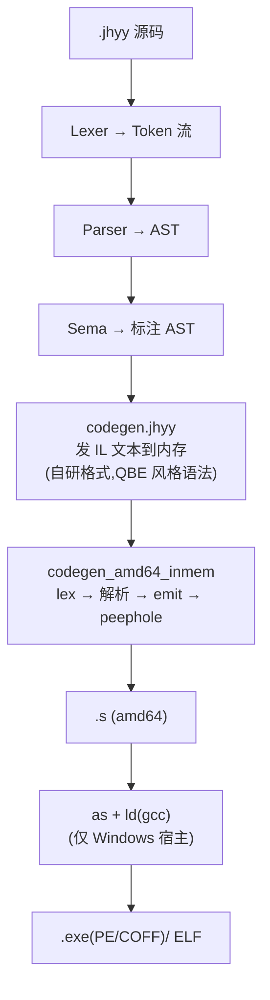
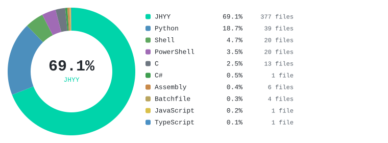

<div align="center">

<div></div>

<div></div>

### JHYY(机会翼游)—— 自研静态类型编译型系统编程语言

**静态类型 · 表达式导向 · 由自研 amd64 后端编译为原生机器码。**

[](docs/archive/logs/v4/changelog-v4.0.0.md)
[](#状态-v415)
[](#架构)
[](#安装)
[](LICENSE)
[](README.md)

[这是什么](#这是什么) · [一段代码看语法](#一段代码看语法) · [安装](#安装) · [快速开始](#快速开始) · [语言特性](#语言特性) · [命令行](#命令行) · [已知限制](#已知限制) · [架构](#架构) · [项目结构](#项目结构) · [状态](#状态-v415) · [路线图](#路线图) · [工具](#工具--集成) · [文档](#文档) · [协议](#协议)

**[English README →](README.md)** ｜ 本页对应 **v4.1.5**;语言规范基线是 **v4.0.0**(锁定于 2026-10-24),v4.1.x 的增量记在 [CHANGELOG.md](CHANGELOG.md)。

**三条读法** —— **想用它** → [安装](#安装) · [快速开始](#快速开始) · [命令行](#命令行) ｜ **想改它** → [CONTRIBUTING.md](CONTRIBUTING.md) ｜ **想读它** → [架构](#架构) · [语言规范](docs/abis/jhyy-lang-spec-v4.0.0.md)

</div>

---

## 这是什么

JHYY(机会翼游)是一门自研的、静态类型的、表达式导向的编译型系统编程语言。
**编译器用自己写的** —— `compiler/src0/*.jhyy` 是**唯一**实现:`jhyy.exe` 编译
`compiler/src0/main.jhyy`,它编出来的编译器再编一次同一份源码,而闭环门
**迭代到不动点**(生成的 `.s` 逐字节相同)—— 不动点是**走到**的,不是假设的。

后端是**自研的内存内 amd64 代码发射器**(`compiler/src0/codegen_amd64_*.jhyy`)——
没有 vendored QBE、没有 LLVM、没有垃圾回收、没有托管式运行时(唯一的运行时是一小份 C
支撑库,v4.5 会把它换成纯 jhyy 实现)。

**它站在哪:** JHYY 在气质上最接近 **C** —— 显式指针、没有隐藏运行时、ABI 可预期;
在抱负上最接近 **Zig** —— 一门自举、目标是能承载内核的系统语言。它**刻意不去**做 Rust:
今天只有最小版借用检查,还没有 trait,也没有 GC。

**设计目标**:

- **自举** —— 编译器编译自己;闭环由「迭代到不动点」验证(跨代 `.s` 逐字节相同)。
- **原生产物** —— 直接发射 amd64 机器码;Windows 上出 PE/COFF 可执行文件,Linux 上出可链成
  ELF 的 SysV 汇编(**编译器本身只在 Windows 上跑**)。
- **面向 OS** —— `extern fn` 走 C ABI 的 FFI、`enum` + `match`、`#[no_std]`、`#[naked]`、
  内联 `asm!`、`#[link_section]`、`volatile`、内存屏障、`defer`。

---

## 一段代码看语法

```rust
// 函数 / 变量 / 控制流 / struct / match / enum / FFI
type Point = struct { x: i32, y: i32 }

fn dist_sq(a: Point, b: Point) -> i32 {
    let dx = a.x - b.x;
    let dy = a.y - b.y;
    dx * dx + dy * dy
}

fn classify(n: i32) -> *u8 {
    match n {
        0        => "zero",
        1..10    => "single digit",
        10 | 20  => "round number",
        _        => "other",
    }
}

extern fn printf(fmt: *u8, val: i32) -> i32;

fn main_jhyy() -> i32 {
    let p = Point { x: 3, y: 4 };
    let q = Point { x: 0, y: 0 };
    printf("d² = %d\n", dist_sq(p, q));
    printf("%s\n", classify(42));
    0
}
```

> ℹ️ 这段代码有两处没展示的东西:字符串字面量**本身就是** `*u8`(NUL 结尾的 UTF-8
> 字节),不需要转换;`extern fn` **不支持变参** —— C 的每个参数都要逐个写出来,
> 而 JHYY 侧声明的参数类型**不做检查**。

---

## 安装

### 最终用户(Windows x64)

从 [**GitHub Releases**](https://github.com/JiHuiYiYou/JiHuiYiYou-compiler/releases/latest)
下安装包。**不需要 MSYS2**:自 v4.1.0 起
安装包自带一份最小原生 ucrt64 工具链(`<INSTALLDIR>\toolchain\`)。

| 产物 | 体积 | 说明 |
|---|---|---|
| [`jhyy-installer-4.1.5.exe`](https://github.com/JiHuiYiYou/JiHuiYiYou-compiler/releases/download/v4.1.5/jhyy-installer-4.1.5.exe) | ~54 MB | GUI 安装器 —— 编译器 + `.jhyy` 文件关联 + VS Code 扩展 + PATH |
| [`jhyy-compiler-4.1.5.msi`](https://github.com/JiHuiYiYou/JiHuiYiYou-compiler/releases/download/v4.1.5/jhyy-compiler-4.1.5.msi) | ~27 MB | 同样内容、无 GUI —— 企业 / SCCM 分发用 |

校验和随产物一起发布在 `SHA256.txt`。

⚠️ **安装器没有做代码签名。** ⇒ 第一次跑会看到「Windows 已保护你的电脑」
⇒ 点「更多信息」→「仍要运行」。未签名的二进制也更容易被第三方杀毒软件误报。
给企业/SCCM 分发用的那个 MSI 同样没签名 ⇒ 有些单位的软件分发策略会**直接拒收**
未签名的 MSI。

**包管理器**:

```powershell
# scoop(个人 bucket)
scoop bucket add jhyy https://github.com/JiHuiYiYou/scoop-bucket
scoop install jhyy
```

`winget install JiHuiYiYou.JHYY` **暂时还装不上** —— 上游 PR 还在等审核。
在那之前用 scoop,或直接用上面的安装器。

两者装的都是 GitHub release 上那个 Burn bundle,装之前都会先校验它的 SHA-256。

**VSCode 用户**:装上扩展后,`.jhyy` 文件标题栏会出现 ▶ 运行按钮(`Ctrl+F5`)。打开本仓库
会触发 `.vscode/settings.json`,把 `compiler/build/bin` 与 MSYS2 的 ucrt64 路径加进集成
终端 —— 按 `Ctrl+Shift+B` 编译并运行任意 `.jhyy` 文件。

### 不是 Windows?

**编译器本体只能在 Windows 上跑** —— `jhyy.exe` 是 PE 可执行文件,宿主必须是
Windows(或 Wine)。这是**设计决策,不是缺陷**
([`docs/internal/build.md`](docs/internal/build.md))。

但**产物**不挑平台:`amd64_sysv*` 目标生成的是 SysV 汇编,可以在 Linux 上链接并运行。
链路就三步:

```bash
# 1. 在 Windows 上 —— 只出 .s(交叉目标不能链)
./compiler/build/bin/jhyy.exe compile --target=amd64_sysv_freestanding --no-link prog.jhyy -o prog
#    ⇒ prog.s

# 2. 在 Linux 上 —— 链成静态 ELF
gcc -nostdlib -static -T runtime/linux_elf/link.ld -o prog.elf \
    runtime/linux_elf/crt0.S prog.s

# 3. 跑它
./prog.elf
```

CI 在 `ubuntu-latest` 上跑的就是这条链路 —— 见
[`compiler/tests/bootstrap/sysv_link_run.sh`](compiler/tests/bootstrap/sysv_link_run.sh)。
Linux 运行时调的是 `main_jhyy`(不是 `main`),并拿它的返回值当退出码 ⇒ 入口约定与
hosted 侧一致;但链接是 `-nostdlib`,所以 freestanding 程序不能调 libc。

### 从源码构建

需要 MSYS2 + `mingw-w64-ucrt-x86_64-gcc`
(这只是**构建编译器**的宿主要求,最终用户不需要):

```bash
git clone https://github.com/JiHuiYiYou/JiHuiYiYou-compiler.git
cd JiHuiYiYou-compiler
make all        # → compiler/build/bin/jhyy.exe(~2 MB)
```

> [!IMPORTANT]
> 别用 Git Bash 自带的 MinGW `gcc`(`/c/Program\ Files/Git/mingw64/bin/gcc.exe`)——
> 它不支持 PE+ 链接,会在链接阶段失败。

工具链那摊事(查找顺序、几个经典坑、版本号自动化、多目标构建)写在
[`docs/internal/build.md`](docs/internal/build.md);贡献者流程在
[`CONTRIBUTING.md`](CONTRIBUTING.md)。

---

## 快速开始

### Hello world

```rust
// hello.jhyy
extern fn puts(s: *u8) -> i32;

fn main_jhyy() -> i32 {
    puts("Hello, world!");
    0
}
```

```bash
./compiler/build/bin/jhyy.exe run hello.jhyy
# => Hello, world!
```

> [!NOTE]
> **入口是 `main_jhyy`,不是 `main`。** hosted 程序必须定义 `main_jhyy`;真实签名是
> `main_jhyy(argc: i32, argv: *u8) -> i32`,`argc` / `argv` 可以不写。C 运行时的 `main`
> 负责桥接过去 —— 见[规范 § 1.1](docs/abis/jhyy-lang-spec-v4.0.0.md)。

### 标准库

JHYY 自带一份小标准库。`import` 拉进来的是**模块** —— **不带 `std::` 前缀**
(`import std::vec;` 是编译错误):

```rust
// stdio.jhyy
import io;

extern fn puts(s: *u8) -> i32;

fn main_jhyy() -> i32 {
    io::std_io_print("hello from the JHYY stdlib\n");
    puts("and from libc, through extern fn");
    0
}
```

| 模块 | 提供什么 |
|---|---|
| `mem` | `mem_copy` / `mem_set` / `mem_zero` / `mem_compare` / `mem_find_byte` |
| `fmt` | `fmt_i32` / `fmt_i64` / `fmt_str` / `fmt_hex_u32` —— 往字节缓冲区里格式化 |
| `io` | 文件 I/O(`std_io_open` / `std_io_read` / `std_io_write` / `std_io_close`)+ `std_io_print` / `std_io_print_err` |
| `math` | `std_math_sin` / `std_math_cos` / `std_math_sqrt` / `std_math_pow` |
| `string` | 带长度前缀的字符串:`str_from_cstr` / `str_concat` / `str_find` / `str_len` |
| `vec` | `std_vec_new` / `std_vec_push` / `std_vec_get` —— 字节向量,**还不是**泛型容器 |
| `os` | 裸 POSIX / Win32 文件描述符 + `getenv` |
| `arena` | bump 分配器:`arena_init` / `arena_alloc` / `arena_reset` |

> ℹ️ 字符串字面量**本身就是** `*u8` —— NUL 结尾的 UTF-8 字节,落在 `.data` 段。
> 旧例子里那个 `as *u8` 是多余的。`\n` 是换行转义(词法器碰巧也接受字面量里的
> 裸换行,但那没写进文档,别依赖它)。

标准库还缺什么 → [已知限制](#已知限制)。

### 跑回归测试

```bash
python regress.py
# => 281 passed, 20 skipped (301 total)
```

这些数字各是什么意思 —— 一个词一个定义(数本身在[状态](#状态-v415)那张表里)。
工具自己报的是 `passed=281/301 failed=0` 与 `skipped=20`:

- **total** —— `compiler/tests/examples/` 下除 `_` 前缀的辅助 fixture 外的每一个
  `.jhyy` 文件。
- **runnable** —— harness 会真的跑它们,每一个都查一个判定信号。
- **真断言** —— 判定信号来自测试源码里写下的断言。
- **由 harness 判定** —— 其余的:要么期待编译失败(`// EXPECT-ERROR:`),要么比对
  进程退出码。
- **skipped** —— 要么带 `// SKIP:` 指令,要么是没有入口的库模块。

断言强度审计(`python scripts/dev/audit_test_assertions.py --strict`)报**零信号 0** ——
没有任何一个用例是靠「什么都没查」蒙过去的。

### 验证自举闭环

```bash
make            # 先编 jhyy.exe,再把闭环迭代到不动点
#   ⇒ _boot_new.s vs _boot_new2.s 逐字节相同
```

### 用 VSCode 跑

装上扩展后,`.jhyy` 文件标题栏会出现 ▶ 运行按钮(`Ctrl+F5`)。

---

## 语言特性

| 类别 | 支持 |
|------|------|
| **类型** | `i8/i16/i32/i64`、`u8/u16/u32/u64`、`f32/f64`、`bool`、`*T`、`[T; N]`、`[*]T`(切片)、`struct`、`enum`、`Cap<T>`、`PhantomData<T>` |
| **尺寸** | `sizeof(T)` / `alignof(T)` —— 编译期常量 |
| **转换** | `as` —— 整数/浮点互转、加宽/收窄、`*T ↔ i64/u64` |
| **控制流** | `if`/`else`(表达式值)、`while`、`for i in start..end`、`break`、`continue`、`match`(字面量/区间/enum/通配,带穷尽性检查) |
| **清理** | `defer` —— 作用域退出时执行(LIFO);函数体末表达式的隐式返回**不触发** |
| **顶层常量** | `const NAME: [T; N] = [...]` —— 编译期落到 `.data` 段 |
| **逻辑** | `&&` / `\|\|` 短路、`!` / `~` 一元 |
| **函数** | 一等值、递归、复合赋值(`+=` `-=` `*=` `/=` `%=`)、块表达式闭包(**不支持捕获** —— 捕获外层变量是编译期报错) |
| **模块** | `import` + 传递导入、多文件 CLI、`mod::fn()` 命名空间 |
| **FFI** | `extern fn` 调 C(printf、文件 I/O、多参数) |
| **OS / 嵌入式** | `#[no_std]`、`#[naked]`、`#[link_section]`、`volatile`、内联 `asm!`、内存屏障 |
| **标准库** | `import mem;` / `fmt` / `io` / `math` / `string` / `vec` / `os` / `arena` —— **不带 `std::` 前缀**(`import std::vec;` 是编译错误) |

这张表里混着差别很大的成熟度。下面这四个最容易被读错:

| 特性 | 状态 | 实际意味着什么 |
|------|------|----------------|
| `[*]T`(切片) | ✅ 能用 | 它是数组上的一个**视图** —— 写会穿透回原数组,而且下标**不做**边界检查 |
| `PhantomData<T>` | ⚠️ 只能是类型层的标记 | 可以作 struct 字段;但**实例化**它是编译错误(`E0050`) |
| `asm!` | ⚠️ 受限 | 只接受**一个字符串字面量** —— 不支持操作数约束、不支持 clobber;AT&T 语法,仅 x86-64 |
| `Cap<T>` | 🚧 只有布局 | 8 字节布局是定的、也能测;但今天还造不出值 —— 真正的能力语义排在 v4.14 |

完整规范:[`docs/abis/jhyy-lang-spec-v4.0.0.md`](docs/abis/jhyy-lang-spec-v4.0.0.md)
(锁定于 2026-10-24;取代 v1.3.0 + 17 份 v3.x supplement,后二者已归档至 git 历史)。
已知限制统一收在它的**附录 B**,不散落在正文里。

---

## 命令行

```text
jhyy compile <file.jhyy> [-o output]   编译 + 链接 -> .exe
jhyy build   <file.jhyy> [-o base]     只编译 -> .s(不链接;-o 是基名,后面会追加 .s)
jhyy run     <file.jhyy>              编译 + 链接 + 执行
jhyy dump    <file.jhyy>              打印解析后的 AST 树(只到 parse)

flag:
  --target=<triple>  选目标(默认 amd64_win)
  --no-link          只出 .s,跳过 gcc 链接(交叉目标**必须**加它)
  --help             打印帮助并退出
```

目标三元组:`amd64_win`(默认,hosted Windows —— **这个 build 唯一能链接的目标**)·
`amd64_win_freestanding`(UEFI)· `amd64_sysv` · `amd64_sysv_freestanding`
(后三个只出 `.s`,要自己拿**与目标匹配**的工具链去链接)。

`jhyy dump` 打印的是**解析后的 AST** —— 每行一个节点,子节点缩进一级,每行带
`@文件:行:列`。它只跑到 parse 为止 ⇒ 看的是**语法**,不是编译结果
(要 `.s` 用 `jhyy build`)。

> ℹ️ **两个意思不同的「build」。** `jhyy build` 是「把一个 `.jhyy` 编成汇编」;
> `make all` 是「把编译器编出来」。两者毫无关系 —— 改任一个的名字都是 breaking change。

命令行的那些怪癖(只收一个输入文件、没有 `--version`、交叉目标……)→
[已知限制](#已知限制)。

---

## 已知限制

下面每一条都是**当下真实存在的限制**,不是路线图上的待办。逐条的权威版本(带锚点)在
规范的[**附录 B**](docs/abis/jhyy-lang-spec-v4.0.0.md#附录-b未实装--已实装但受限);
这一节是它的索引,按「写代码时会撞上」还是「只是敲命令时会撞上」分成两组。

### 写代码会撞上的

- **字符串字面量是 `*u8`** —— NUL 结尾的 UTF-8,落在 `.data`。它不是切片、不是数组:
  `let s: [*]u8 = "x";` 是类型错误(要写 `as [*]u8`)。
- **`extern fn` 不支持变参** —— 像 `printf` 这样的 C 函数必须把每个参数逐个声明出来,
  而声明的参数类型**不检查**是否与 C 侧一致。对不上照样编过,运行时才出事。
- **函数实参类型不做检查** —— 把 `i32` 传给 `struct` 形参能编译通过,运行时按 struct
  布局读寄存器。
- **源文件是 UTF-8。** 词法器接受字符串字面量里的裸换行,但那没写进规范 —— 写 `\n`。
- **`Cap<T>` 造不出值** —— 8 字节布局是定的,但今天还没有可构造的值。
- **`PhantomData<T>` 不能实例化**(`E0050`) —— 它只是类型层的标记。
- **切片没有边界检查** —— 下标不检查;穿过切片写会写回原数组。
- **`asm!` 只能是一个字符串字面量** —— 不支持操作数约束、不支持 clobber;AT&T 语法,
  仅 x86-64。
- **`()` 在类型位置不被接受** —— `let x: () = ();` 是解析错误。
- **顶层变量的初始化器必须是整数常量表达式** —— 非整数的初始化器会被**静默丢弃**,
  读回来是 `0`。
- **标准库还很小、很年轻** —— 没有浮点格式化,没有 `abs` / `min` / `max`,没有元素类型上的
  `Vec<T>`,也还没有 `print` 宏。

### 只在敲命令时会撞上的

- **没有 `jhyy --version`** —— 它从来就不存在。跑它会打
  `jhyy: unknown option --version`(外加一句 `try jhyy --help`)并 **exit 1**。
  版本横幅在 **`jhyy --help` 的首行**(不带参数跑 `jhyy` 也一样 ——
  两条路径现在打的是**同一份**帮助)。
- **命令行只接受一个输入文件。** 多余的 `.jhyy` 参数会被**静默忽略** ——
  不报错、不警告 ⇒ `jhyy compile main.jhyy lib.jhyy` 实际**只编 `main.jhyy`**。
  多文件请用 `import` 组合:在 `main.jhyy` 里写 `import lib;`,
  编译器会沿 import 图把 `lib.jhyy` 一起编进来。
- **不认识的选项会被拒绝** —— `jhyy compile --foo a.jhyy` 报
  `compile: unknown option --foo`,不会把这个 flag 当成文件名。
- **交叉目标在这个 build 里链不了。** `--target=amd64_sysv`(以及两个 freestanding)
  生成的是**那个目标的 ABI** 的代码,但自带的链接器永远产出 **Windows `.exe`** ——
  拿它链一个 SysV 的 `.s`,得到的是**第一次调 libc 就崩**的二进制。
  ⇒ 编译器现在**拒绝**链接交叉目标:加 `--no-link`,自己拿匹配的工具链链那个 `.s`
  (仓里的 `runtime/linux_elf/` 就是干这个的)。
- **`jhyy build` 与 `jhyy compile --no-link` 产出逐字节相同的 `.s`**
  (两条路径都处理 `#[link_section]`,`.section` 指令也一致)。这个等价性由
  `link_section_build` 那道产物级门钉住。

---

## 架构



| 部件 | 位置 | 职责 |
|------|------|------|
| `compiler/src0/*.jhyy` | 31 个模块 | **唯一的**编译器 —— lexer、parser、sema、IR、codegen、target dispatch |
| `compiler/src0/codegen_amd64_*.jhyy` | 自研后端 | IL lexer · 发射器(`emit_call`/`emit_ctrl`/`emit_mem`/`emit_sse`)· peephole · 寄存器缓存 |
| `compiler/src0/std/*.jhyy` | 8 个模块 | `mem` `fmt` `io` `math` `string` `vec` `os` `arena` |
| `compiler/runtime/runtime.c` | C 运行时 | Arena 分配器 + `main` → `main_jhyy` 桥接 |
| `runtime/linux_elf/` | crt0.S + link.ld | `amd64_sysv*` 目标的 Linux ELF 运行时 |

**为什么没有 QBE?** QBE 在 v4.0.0(接在 v2.16.0 之后)被移除。自研后端现在是唯一的
codegen 路径 —— 少一个 17K-LOC 的 vendored 依赖,同时也让 codegen 本身的迭代更快。
**IL 文本是 JHYY 自己的格式**:它借了 QBE 的*语法*当起点,但没有 vendored、没有链接、
更没有执行任何 QBE 代码。

---

## 项目结构

```
JiHuiYiYou-compiler/
├── compiler/
│   ├── src0/                   编译器源码(唯一实现,31 个模块 + std/)
│   │   ├── std/                标准库:mem / fmt / io / math / string / vec / os / arena
│   │   └── codegen_amd64_*.jhyy 自研后端:IL lexer / emit_* / peephole / 寄存器缓存
│   ├── runtime/                C 运行时(Arena + main 入口)
│   ├── tests/
│   │   ├── examples/           集成测试 —— 301 个用例(+9 个 `_` 前缀 fixture)· 5 个子目录;regress.py 自动跑
│   │   └── bootstrap/          fixed_point.sh · closure_check.sh · artifact_checks.sh · byte_equal*.sh
│   └── build/bin/              jhyy.exe · jhyy_v1.exe.exe(自举产物)
├── runtime/linux_elf/          Linux ELF 运行时(crt0.S + link.ld)
├── bench/                      基准套件(题目 + 驱动 + 口径 + 可发布快照)
├── regress.py                  回归测试套件(仓库根)
├── docs/                       规范 / 内部文档 / 计划 / changelog
├── installer/                  WiX 安装器 + 内置 ucrt64 工具链
├── mcp-jhyy/                   Claude Code MCP 服务(jhyy_* 工具)
├── vscode-ext/                 VS Code 扩展
└── scripts/dev/                开发脚本(bench / test / build / install)
```

> ℹ️ `jhyy_v1.exe.exe` **不是笔误**:`make` 每次构建都会把它重新生成成 `jhyy.exe` 的
> 逐字节副本,双后缀是历史留下来的名字。它是构建产物、不是输入 —— 但有两道本地
> 自举门(`byte_equal.sh`、`fixed_point.sh`)**默认按这个确切路径**取「第 1 代」
> 参照物,所以改名字会让它们静默失效。

---

## 状态 (v4.1.5)

说人话:**回归套件是全绿的** —— 每个可跑的用例都有判定、没有一个失败。编译器编译自己
得到逐字节相同的结果,workaround 台账里**没有已知未修的编译器 bug**。下面的表是
机器可读版本;这些数字的单一真相源是 [FACTS.md § 2](docs/internal/FACTS.md)。

| 指标 | 值 |
|------|-----|
| `regress.py`(回归套件) | **281 PASS + 0 XFAIL + 0 failed + 20 SKIP**(301 total) |
| 断言强度审计 | 扫 301 · 可跑 281 · 真断言 217 · 零信号 0 |
| 基准套件 | 9 道题 · 4 个覆盖轴 —— [已发布快照](bench/baseline/RESULTS-2026-11-04.md)(jhyy 与 gcc 的墙钟对比;**代码生成质量的地板是 gcc `-O0`**,不是及格线) |
| 自举闭环 | `make` 迭代到不动点 —— 生成的 `.s` 跨代逐字节相同 |
| `fixed_point.sh` | 本地门(不接 CI)—— N=10 代,`.il` 与 `.s` 跨代 byte-equal |
| `artifact_checks.sh` | **21 道产物级门**(PASS 21 / KNOWN-FAIL 0 / FAIL 0) |
| `closure_check.sh` | 本地门(不接 CI)—— v2.s == v3.s,逐字节相同 |
| ACTIVE workaround | **0** —— 见 [FACTS.md § 3](docs/internal/FACTS.md) |
| `jhyy-installer-4.1.5.exe` | 已发布(~54 MB,含 .NET 8 Desktop Runtime + 内置 ucrt64 工具链) |
| `jhyy-compiler-4.1.5.msi` | 已发布(~27 MB,含 `jhyy-setuc.exe` + 内置工具链) |
| `jhyy-lang-4.1.5.vsix` | 已发布(VS Code 扩展) |
| 语言构成 | **69.7%** 的代码是 JHYY —— 53105 行里的 36992 行，377 个文件 —— [FACTS.md § 7](docs/internal/FACTS.md) <!-- langstat:row --> |

<picture>
  <source media="(prefers-color-scheme: dark)" srcset="docs/internal/langstat-dark.svg">
  
</picture>

**变更日志** —— [`CHANGELOG.md`](CHANGELOG.md) 每版一行;逐轴的详细记录是 v4 的
umbrella:[`docs/archive/logs/v4/changelog-v4.0.0.md`](docs/archive/logs/v4/changelog-v4.0.0.md)
(按项目的 umbrella 约定,每个版本轴只有一份)。

**「逐字节相同」证了什么、没证什么。** 闭环门证的是编译器能**把自己原样复现**——
这是关于*生成确定性*的结论,不是关于*语义正确性*的结论(经典的 "trusting trust" 缺口)。
语义正确性由 `regress.py` 单独覆盖。

**「没有已知未修的编译器 bug」是什么意思。** 台账是公开且持续维护的
([`docs/internal/workarounds.md`](docs/internal/workarounds.md))——「已知」指的是
**登记在册**的没有,不是「不存在」的证明。

### 今天能做什么、不能做什么

JHYY 是**1.0 之前的项目** —— 自举成立、回归全绿,但**还不是 C / Rust 的替代品**。

| 你想做 | 今天 |
|---|---|
| 写一个自举的系统语言程序 | ✅ 可以 —— 编译器编译自己 |
| 调 C 库 | ✅ `extern fn` 走 C ABI |
| 写 freestanding / `no_std` 程序 | ⚠️ 可以,但 UEFI 入口那条路还没做完(abi § 12.8) |
| 用带 trait 的泛型 | ❌ 还没有 —— 排在 v4.12 |
| 用会捕获变量的闭包 | ❌ 还没有 —— 今天写就是编译错误 |
| 打印一个浮点数 | ❌ `fmt` 还没有浮点格式化 |
| 编译到 aarch64 / riscv64 | ❌ 只有 x86-64 |
| 拿它上生产 | ⚠️ 暂不建议 —— 1.0 之前,规范还在演进 |

排期的权威来源是 [FACTS.md § 4](docs/internal/FACTS.md);OS 线的设计记录在
[`docs/coordination/`](docs/coordination/)。

---

## 路线图

v4.x 是合并后的版本轴。**排期的权威来源** —— 每格一个版本槽、每格做什么、
以及稳定的 `OS-N` 序号 —— 在 [`docs/internal/FACTS.md`](docs/internal/FACTS.md) § 4。
计划按版本槽一份,放在 [`docs/plans/v4/`](docs/plans/v4/README.md)。

**当前主线**:自研后端的性能线(自研 amd64 后端的寄存器分配),其后是 OS 线
(v4.6 → v4.15,稳定身份 `OS-1` … `OS-16`)。

预留槽上的版本号是**占位号** —— 每份计划都带「启动时复核清单」,那一格被启动时
按当时的实际状态重新核对。

---

## 工具 & 集成

### Claude Code MCP 服务

`mcp-jhyy/` 提供 **11 个 MCP 工具**:

| 工具 | 用途 |
|------|------|
| `jhyy_run` / `jhyy_check` / `jhyy_compile` | 编译 / 运行 / 检查 `.jhyy` |
| `jhyy_get_il` | 取中间表示(调试 codegen 用) |
| `jhyy_regress` | 跑回归,返回 PASS/FAIL 列表 |
| `jhyy_il_diff` | 两个 `.il` 的 byte-equal 检查 + 上下文 diff |
| `jhyy_selfhost_check` | 一键自举闭环验证(v1→v2→v3→v4) |
| `jhyy_workarounds` | 查 W-NNN workaround 状态 / 详情 |
| `jhyy_lang_ref` / `jhyy_abi_info` / `jhyy_format` | 语言 / ABI / 格式化查询 |

安装:`pip install fastmcp`(⚠️ **不是** `mcp[cli]` —— 顶层 `fastmcp` 是独立发行包)。
详见 [`mcp-jhyy/README.md`](mcp-jhyy/README.md)。

### VS Code 扩展

`vscode-ext/` 提供语法高亮(TextMate grammar + 文件图标)+ 原生 ▶ `Run JHYY File`
(`Ctrl+F5`)+ `Compile JHYY File (no run)` 命令。最近 shipped = `jhyy-lang-4.1.5.vsix`。

---

## 文档

- **Wiki**(中文)—— README 的长文版:[导览、指南与常见问题](https://github.com/JiHuiYiYou/JiHuiYiYou-compiler/wiki/首页)
- **全仓文档地图** —— 各文档各管什么:[`docs/internal/README.md`](docs/internal/README.md)
- **语言规范**:[`docs/abis/jhyy-lang-spec-v4.0.0.md`](docs/abis/jhyy-lang-spec-v4.0.0.md)(锁定)
- **ABI 白皮书**:[`docs/abis/jhyy-abi-v4.0.0.md`](docs/abis/jhyy-abi-v4.0.0.md)(锁定)
- **二进制格式**(设计稿,未实装):[`docs/abis/jhyy-binary-format-v1.0.0.md`](docs/abis/jhyy-binary-format-v1.0.0.md)
- **当前事实**(版本、回归数、排期):[`docs/internal/FACTS.md`](docs/internal/FACTS.md)
- **架构**:[`docs/internal/architecture.md`](docs/internal/architecture.md)
- **构建与运行**:[`docs/internal/build.md`](docs/internal/build.md)
- **workaround 台账**:[`docs/internal/workarounds.md`](docs/internal/workarounds.md)
- **当前计划**:[`docs/plans/v4/`](docs/plans/v4/README.md)
- **跨项目设计**(编译器侧 / OS 侧):[`docs/coordination/`](docs/coordination/)
- **性能基线**:[`docs/perf/self-backend-baseline-2026-10-29.md`](docs/perf/self-backend-baseline-2026-10-29.md)
- **贡献指南**:[`CONTRIBUTING.md`](CONTRIBUTING.md)(英文)
- **变更日志**:[`CHANGELOG.md`](CHANGELOG.md)(英文;每版一行)
- **归档**:[`docs/archive/`](docs/archive/README.md)(历史 —— 已作废的计划、旧 changelog)

---

## 协议

MIT —— 见 [`LICENSE`](LICENSE)。

---

## 贡献者

- **人类作者**:JHYY
- **AI 辅助**:设计、编码、调试与文档由 AI 编码辅助工具
  ([Claude Code](https://claude.ai/code) CLI 工作流)参与产出。

自 v0.6 起所有 sprint 均由人机协作完成。

---

<sub>v4.1.5 — 2026-11-09 · 版本号自动化(`VERSION` 单一真相源)· 自研 amd64 后端</sub>
