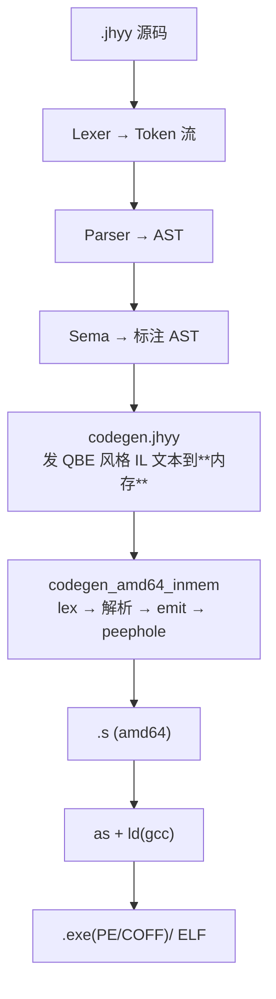

<div align="center">

<div></div>

<div></div>

### 机会翼游 — 自研静态类型编译型系统编程语言

**静态类型 · 表达式导向 · 由自研 amd64 后端编译为原生机器码。**

[](docs/archive/logs/v4/changelog-v4.0.0.md)
[](#状态-v412)
[](#架构)
[](#安装)
[](LICENSE)
[](README.md)

[快速开始](#快速开始) · [安装](#安装) · [语言特性](#语言特性) · [命令行](#命令行) · [架构](#架构) · [状态](#状态-v412) · [路线图](#路线图) · [文档](#文档)

</div>

---

## 这是什么

JHYY(机会翼游)是一门自研的、静态类型的、表达式导向的编译型系统编程语言。
**编译器用自己写的** —— `compiler/src0/*.jhyy` 是**唯一**实现:`jhyy.exe` 编译
`compiler/src0/main.jhyy`,它编出来的编译器再编一次同一份源码,而闭环门
**迭代到不动点**(生成的 `.s` 逐字节相同)—— 不动点是**走到**的,不是假设的。

后端是**自研的内存内 amd64 代码发射器**(`compiler/src0/codegen_amd64_*.jhyy`)——
没有 vendored QBE、没有 LLVM、没有 GC、没有运行时。

**设计目标**:

- **自举** —— 编译器编译自己;闭环由「迭代到不动点」验证(跨代 `.s` 逐字节相同)。
- **原生产物** —— 直接发射 amd64 机器码;PE/COFF(Windows)与 ELF(Linux)二进制。
- **面向 OS** —— `extern fn` 走 C ABI 的 FFI、`enum` + `match`、`#[no_std]`、`#[naked]`、
  内联 `asm!`、`#[link_section]`、`volatile`、内存屏障、`defer`。

---

## 一段代码看语法

```rust
// 函数 / 变量 / 控制流 / struct / match / enum / FFI
type Point = struct { x: i32, y: i32 }

fn dist_sq(a: Point, b: Point) -> i32 {
    let dx = a.x - b.x;
    let dy = a.y - b.y;
    dx * dx + dy * dy
}

fn classify(n: i32) -> *u8 {
    match n {
        0        => "zero",
        1..10    => "single digit",
        10 | 20  => "round number",
        _        => "other",
    }
}

extern fn printf(fmt: *u8, val: i32) -> i32;

fn main_jhyy() -> i32 {
    let p = Point { x: 3, y: 4 };
    let q = Point { x: 0, y: 0 };
    printf("d² = %d\n", dist_sq(p, q));
    printf("%s\n", classify(42));
    0
}
```

---

## 安装

**最终用户(Windows x64)** —— 下安装包即可。**不需要 MSYS2**:自 v4.1.0 起
MSI 自带一份最小原生 ucrt64 工具链(`<INSTALLDIR>\toolchain\`)。

| 产物 | 体积 | 说明 |
|---|---|---|
| `jhyy-installer-4.1.2.exe` | ~55 MB | GUI 安装器 —— 编译器 + `.jhyy` 文件关联 + VS Code 扩展 + PATH |
| `jhyy-compiler-4.1.2.msi` | ~28 MB | 同样内容、无 GUI —— 企业 / SCCM 分发用 |

**从源码构建** —— 需要 MSYS2 + `mingw-w64-ucrt-x86_64-gcc`
(这只是**构建编译器**的宿主要求,最终用户不需要):

```bash
make all        # → compiler/build/bin/jhyy.exe(~1.9 MB)
```

> [!IMPORTANT]
> 别用 Git Bash 自带的 MinGW `gcc`(`/c/Program\ Files/Git/mingw64/bin/gcc.exe`)——
> 它不支持 PE+ 链接,会在链接阶段失败。

**Docker**:

```bash
# 编译器宿主 —— 完整工具链(Windows)
docker run -it msys2/mingw-w64-ucrt-x86_64 bash
# amd64_sysv 目标工具链 —— 在 Linux 上链接 + 运行生成的 .s
# (jhyy.exe 是 PE 二进制:在这个容器里**跑不起来**)
docker run -it gcc:12 bash
```

**VSCode 用户**:打开本仓库会触发 `.vscode/settings.json`,把 `compiler/build/bin`
与 MSYS2 的 ucrt64 路径加进集成终端。按 `Ctrl+Shift+B` 编译并运行任意 `.jhyy` 文件。

---

## 快速开始

### Hello world

```rust
// hello.jhyy
fn main_jhyy() -> i32 {
    42
}
```

```bash
./compiler/build/bin/jhyy.exe run hello.jhyy
echo $?    # => 42
```

### 跑回归测试

```bash
python regress.py
# => 259/259 passed (全部有断言), 0 failed, 20 skipped (of 279 total)
```

### 验证自举闭环

```bash
make            # 先编 jhyy.exe,再把闭环迭代到不动点
#   ⇒ _boot_new.s vs _boot_new2.s 逐字节相同
```

### 用 VSCode 跑

装上扩展后,`.jhyy` 文件标题栏会出现 ▶ 运行按钮(`Ctrl+F5`)。

---

## 语言特性

| 类别 | 支持 |
|------|------|
| **类型** | `i8/i16/i32/i64`、`u8/u16/u32/u64`、`f32/f64`、`bool`、`*T`、`[T; N]`、`[*]T`(切片)、`struct`、`enum`、`Cap<T>`、`PhantomData<T>` |
| **尺寸** | `sizeof(T)` / `alignof(T)` —— 编译期常量 |
| **转换** | `as` —— 整数/浮点互转、加宽/收窄、`*T ↔ i64/u64` |
| **控制流** | `if`/`else`(表达式值)、`while`、`for i in start..end`、`break`、`continue`、`match`(字面量/区间/enum/通配,带穷尽性检查) |
| **清理** | `defer` —— 作用域退出时执行(LIFO);函数体末表达式的隐式返回**不触发** |
| **顶层常量** | `const NAME: [T; N] = [...]` —— 编译期落到 `.data` 段 |
| **逻辑** | `&&` / `\|\|` 短路、`!` / `~` 一元 |
| **函数** | 一等值、递归、复合赋值(`+=` `-=` `*=` `/=` `%=`)、块表达式闭包(**不支持捕获** —— 捕获外层变量是编译期报错) |
| **模块** | `import` + 传递导入、多文件 CLI、`mod::fn()` 命名空间 |
| **FFI** | `extern fn` 调 C(printf、文件 I/O、多参数) |
| **OS / 嵌入式** | `#[no_std]`、`#[naked]`、`#[link_section]`、`volatile`、内联 `asm!`、内存屏障 |
| **标准库** | `import mem;` / `fmt` / `io` / `math` / `string` / `vec` / `os` / `arena` —— **不带 `std::` 前缀**(`import std::vec;` 是编译错误) |

完整规范:[`docs/abis/jhyy-lang-spec-v4.0.0.md`](docs/abis/jhyy-lang-spec-v4.0.0.md)
(锁定于 2026-10-24;取代 v1.3.0 + 17 份 v3.x supplement,后二者已归档至 git 历史)。
已知限制统一收在它的**附录 B**,不散落在正文里。

---

## 命令行

```text
jhyy compile <file.jhyy> [-o output]   编译 + 链接 -> .exe
jhyy build   <file.jhyy> [-o output]   只编译 -> .s(不链接)
jhyy run     <file.jhyy>              编译 + 链接 + 执行
jhyy dump    <file.jhyy>              ⚠️ 尚未实现(退出码 1)

flag:
  --target=<triple>  选目标(默认 amd64_win)
  --no-link          只出 .s,跳过 gcc 链接(给交叉工具链用)
  --help             打印帮助并退出
```

目标三元组:`amd64_win`(默认,hosted Windows)· `amd64_win_freestanding`(UEFI)·
`amd64_sysv` · `amd64_sysv_freestanding`。

> [!TIP]
> 多文件编译:把每个 `.jhyy` 源文件都列在命令行上 ——
> `jhyy compile main.jhyy lib.jhyy -o app`
>
> ⚠️ **没有 `jhyy --version`** —— 它从来就不存在。跑它会打一行 `unknown command`
> 并 **exit 1**。版本横幅在 **`jhyy --help` 的首行**(不带参数跑 `jhyy` 也一样)。
>
> ⚠️ `jhyy build` 与 `jhyy compile --no-link` **不等价**:后者在产出 `.s` 之后还会跑
> `apply_link_section_directives`,`build` 不跑 ⇒ 用了 `#[link_section]` 的程序两条路径
> 产出的 `.s` 不同(见 `W-170`)。工具链请用 `compile --no-link`。

---

## 架构



| 部件 | 位置 | 职责 |
|------|------|------|
| `compiler/src0/*.jhyy` | 30 个模块 | **唯一的**编译器 —— lexer、parser、sema、IR、codegen、target dispatch |
| `compiler/src0/codegen_amd64_*.jhyy` | 自研后端 | IL lexer · 发射器(`emit_call`/`emit_ctrl`/`emit_mem`/`emit_sse`)· peephole · 寄存器缓存 |
| `compiler/src0/std/*.jhyy` | 8 个模块 | `mem` `fmt` `io` `math` `string` `vec` `os` `arena` |
| `compiler/runtime/runtime.c` | C 运行时 | Arena 分配器 + `main` → `main_jhyy` 桥接 |
| `runtime/linux_elf/` | crt0.S + link.ld | `amd64_sysv*` 目标的 Linux ELF 运行时 |

**为什么没有 QBE?** QBE 在 v4.0.0(接在 v2.16.0 之后)被移除。自研后端现在是唯一的
codegen 路径 —— 少一个 17K-LOC 的 vendored 依赖,同时也让 codegen 本身的迭代更快。

---

## 项目结构

```
JiHuiYiYou-compiler/
├── compiler/
│   ├── src0/                   编译器源码(唯一实现,30 个模块 + std/)
│   │   ├── std/                标准库:mem / fmt / io / math / string / vec / os / arena
│   │   └── codegen_amd64_*.jhyy 自研后端:IL lexer / emit_* / peephole / 寄存器缓存
│   ├── runtime/                C 运行时(Arena + main 入口)
│   ├── tests/
│   │   ├── examples/           集成测试(274 个 .jhyy + 5 个子目录)— regress.py 自动跑
│   │   └── bootstrap/          fixed_point.sh · closure_check.sh · artifact_checks.sh · byte_equal*.sh
│   └── build/bin/              jhyy.exe · jhyy_v1.exe.exe(自举产物)
├── runtime/linux_elf/          Linux ELF 运行时(crt0.S + link.ld)
├── regress.py                  回归测试套件(仓库根)
├── docs/                       规范 / 内部文档 / 计划 / changelog
├── installer/                  WiX 安装器 + 内置 ucrt64 工具链
├── mcp-jhyy/                   Claude Code MCP 服务(jhyy_* 工具)
├── vscode-ext/                 VS Code 扩展
├── scripts/dev/                开发脚本(bench / test / build / install)
└── tools/                      跨仓工具
```

---

## 状态 (v4.1.2)

| 指标 | 值 |
|------|-----|
| `regress.py` | **259 PASS + 0 XFAIL + 0 failed + 20 SKIP**(279 total) |
| 断言强度审计 | 扫 279 / 可跑 259 / 真断言 200 / 零信号 0 |
| 自举闭环 | `make` 迭代到不动点 —— 生成的 `.s` 跨代逐字节相同 |
| `fixed_point.sh` | **17 PASS / 0 FAIL**(N=10,`.il` 与 `.s` 跨代 byte-equal) |
| `artifact_checks.sh` | **17 PASS / 0 FAIL** |
| `closure_check.sh` | PASS(v2.s == v3.s,逐字节相同) |
| ACTIVE workaround | **1** —— [`W-170`](docs/workarounds.md):`jhyy build` 不处理 `#[link_section]` |
| `jhyy-installer-4.1.2.exe` | 已发布(~55 MB,含 .NET 8 Desktop Runtime + 内置 ucrt64 工具链) |
| `jhyy-compiler-4.1.2.msi` | 已发布(~28 MB,含 `jhyy-setuc.exe` + 内置工具链) |
| `jhyy-lang-4.1.2.vsix` | 已发布(VS Code 扩展) |

**v4.x umbrella changelog** —— [`docs/archive/logs/v4/changelog-v4.0.0.md`](docs/archive/logs/v4/changelog-v4.0.0.md)
是本仓**每个版本轴唯一**的 changelog(按项目的 umbrella 约定)。

---

## 路线图

v4.x 是合并后的版本轴。计划按版本槽一份,放在 [`docs/plans/v4/`](docs/plans/v4/README.md) ——
那份是权威索引;排期见 [`docs/archive/plans/v4/version-schedule.md`](docs/archive/plans/v4/version-schedule.md)。

**性能线**(自研后端 —— 当前主线):

| 版本 | 意图 |
|------|------|
| **v4.4.0** ⭐ | **寄存器分配** —— 阶段一(分配器 + 安全网,产物逐字节不变)已完成;阶段二是 emit 层消费寄存器 |
| v4.4.1 / v4.4.2 / v4.4.3 | call-clobber + 寄存器类 / 跨基本块 + phi 并行移动 / 门 + perf 验证 |
| v4.4.5 | peephole 4096 限制 + IR 优化框架(两版降级下来的) |
| v4.5 | M5 Part 3 —— 最后一项 0-C 闭环 |

**OS 线**(v4.6 → v4.15,稳定身份 `OS-1` … `OS-16`):止血包 → 栈观测 → 反馈环 →
ABI 收敛 → 语言自洽 → 效果系统 → lifetime → trait + `dyn Trait` → const generic →
HKT → 能力类型化 → 可信工具链。

预留槽上的版本号是**占位号** —— 每份计划都带「启动时复核清单」,那一格被启动时
按当时的实际状态重新核对。

---

## 工具 & 集成

### Claude Code MCP 服务

`mcp-jhyy/` 提供 **11 个 MCP 工具**:

| 工具 | 用途 |
|------|------|
| `jhyy_run` / `jhyy_check` / `jhyy_compile` | 编译 / 运行 / 检查 `.jhyy` |
| `jhyy_get_il` | 取中间表示(调试 codegen 用) |
| `jhyy_regress` | 跑回归,返回 PASS/FAIL 列表 |
| `jhyy_il_diff` | 两个 `.il` 的 byte-equal 检查 + 上下文 diff |
| `jhyy_selfhost_check` | 一键自举闭环验证(v1→v2→v3→v4) |
| `jhyy_workarounds` | 查 W-NNN workaround 状态 / 详情 |
| `jhyy_lang_ref` / `jhyy_abi_info` / `jhyy_format` | 语言 / ABI / 格式化查询 |

安装:`pip install fastmcp`(⚠️ **不是** `mcp[cli]` —— 顶层 `fastmcp` 是独立发行包)。
详见 [`mcp-jhyy/README.md`](mcp-jhyy/README.md)。

### VS Code 扩展

`vscode-ext/` 提供语法高亮(TextMate grammar + 文件图标)+ 原生 ▶ `Run JHYY File`
(`Ctrl+F5`)+ `Compile JHYY File (no run)` 命令。最近 shipped = `jhyy-lang-4.1.2.vsix`。

---

## 文档

- **语言规范**:[`docs/abis/jhyy-lang-spec-v4.0.0.md`](docs/abis/jhyy-lang-spec-v4.0.0.md)(锁定)
- **ABI 白皮书**:[`docs/abis/jhyy-abi-v4.0.0.md`](docs/abis/jhyy-abi-v4.0.0.md)(锁定)
- **二进制格式**(设计稿,未实装):[`docs/abis/jhyy-binary-format-v1.0.0.md`](docs/abis/jhyy-binary-format-v1.0.0.md)
- **架构**:[`docs/internal/architecture.md`](docs/internal/architecture.md)
- **构建与运行**:[`docs/internal/build.md`](docs/internal/build.md)
- **测试**:[`docs/FACTS.md`](docs/FACTS.md)
- **workaround 台账**:[`docs/workarounds.md`](docs/workarounds.md)
- **编码约定**:[`CONTRIBUTING.md`](CONTRIBUTING.md)
- **变更日志**:[`docs/archive/logs/v4/changelog-v4.0.0.md`](docs/archive/logs/v4/changelog-v4.0.0.md)(v4 umbrella)
- **归档计划**:[`docs/archive/plans/v2-v3/`](docs/archive/plans/v2-v3/)(v2/v3 历史 —— 已作废)

---

## 协议

MIT —— 见 [`LICENSE`](LICENSE)。

---

## Contributors

- **人类作者**:JHYY
- **AI 协作**:MiniMax-M3(通过 [Claude Code](https://claude.ai/code) CLI 工作流参与设计、编码、调试、文档)

自 v0.6 起所有 sprint 的实现 + 文档由 JHYY + MiniMax-M3 协作完成。

---

<sub>v4.1.2 — 2026-10-29 · 版本号自动化(`VERSION` 单一真相源)· 自研 amd64 后端</sub>
